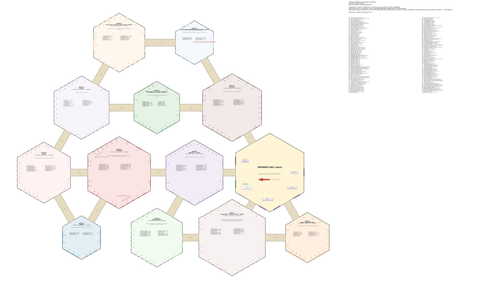
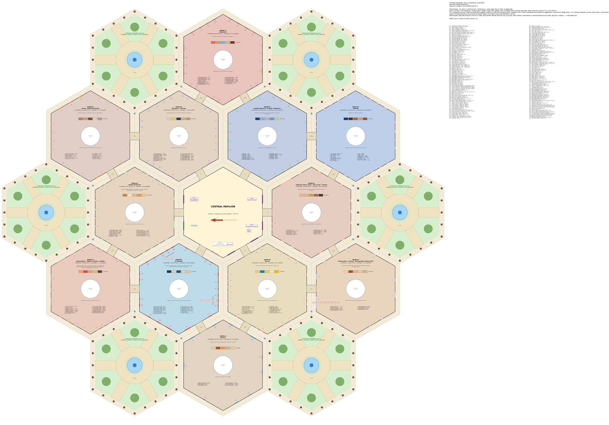
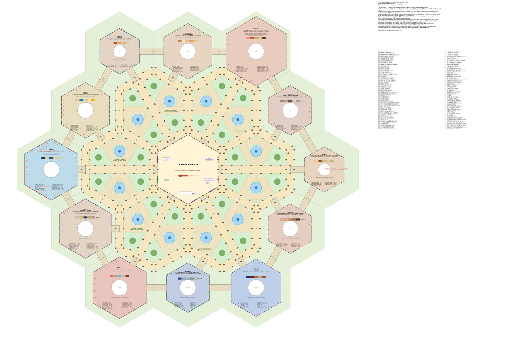
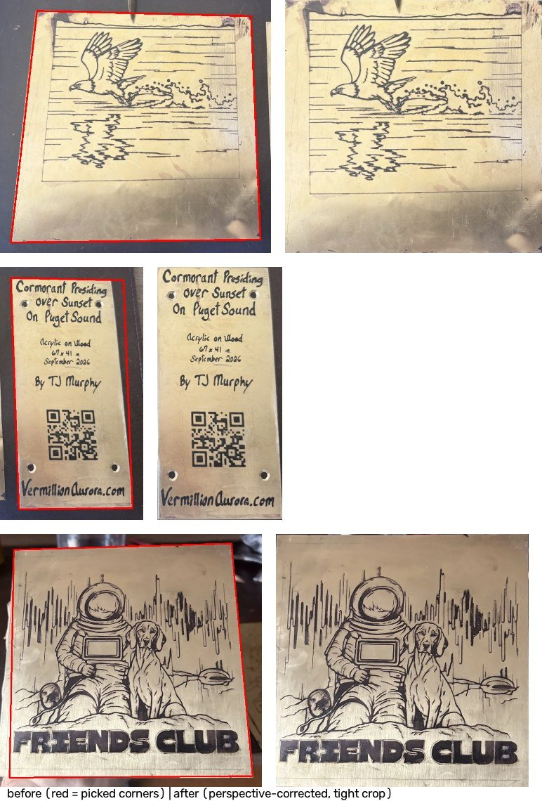
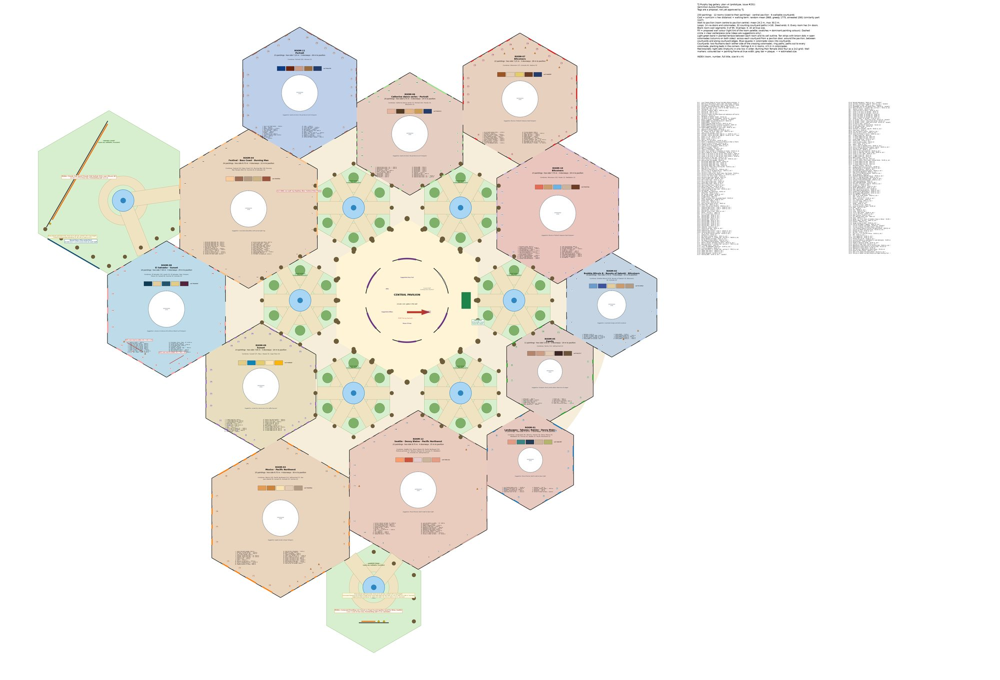

# Designing a Honeycomb Gallery, One Diagram at a Time

I tag every painting I make: where it was painted, who is in it, what it's about. A while ago I started wondering if those tags could become the floor plan of a gallery. Mexico paintings in one room, Burning Man in another, and rooms whose tags overlap sitting next to each other, so walking from one to the next feels natural.

This is how that plan came together. There is no 3D build yet. I asked for a labeled, high-res diagram first, and we went through four versions of it before I was happy.

## Version 1: a honeycomb sorted by tags

My first request was simple to say and harder to do. I wanted a honeycomb of hexagonal rooms, clustered by tag, and I wanted it treated as an optimization problem: rooms with overlapping tags should sit near each other. A room could hold more than one related tag. The whole thing had to be one big loop with no dead ends, so you never have to turn around and walk back the way you came. There would be a minimap so you always know where you are. And before anyone built anything, I wanted to see a labeled diagram at full resolution.

Here's how the optimizer works, in plain words:

1. **Tag similarity.** Every pair of tags gets a score for how often they show up on the same paintings. Festival and Bass Coast share a lot. Mexico and Seattle share almost nothing.
2. **Clustering.** Tags that score high together are grouped into rooms, so one room can be "Burning Man, Festival, Burning Man Temple 2022" instead of three thin rooms.
3. **Placing rooms on a hex grid.** The rooms then get shuffled around a honeycomb with simulated annealing. It starts with a random arrangement and keeps trying small swaps. A swap that puts similar rooms next to each other is kept. Early on it also accepts some bad swaps so it doesn't get stuck, and it gets pickier as it "cools." The end result is a layout where neighbours have the most in common.

## Version 2: light and airy

The first plan worked, but it felt like a maze of closed boxes. I wanted it light and airy. So I asked for:

- open-air courtyards with fountains, set as hex cells between the rooms
- open colonnade hallways that look into the courtyards
- high ceilings
- wall colours taken from each room's own paintings
- a centerpiece zone in the middle of every room
- a central pavilion with the checkout and gates to my other galleries, plus a "coming soon" gate for a future concert hall
- triptychs hung in one row, in order
- the four Burning Man Temple paintings hung as a 2x2 grid
- no blank walls anywhere
- rooms that grow or shrink with how many paintings they hold

The wall colour for each room is a light tint of the strongest colour that keeps showing up across its paintings. Hallway windows look into the courtyards, so the room walls stay free for paintings.

## Version 3: courtyards you can walk through

In v2 the courtyards were mostly something to look at. I wanted to step out between the columns, walk around the fountains, and use the paths as shortcuts to the other side.

So each courtyard got a fountain with a ring path around it, paths out to every colonnade edge, and planting beds tucked into the corners away from the paths. The pavilion moved to the centre with six courtyards around it and twelve rooms in an outer ring, each room sized to its paintings.

## Version 4: tighter, and the murals come outside

My note on v3 was that it looked pretty good. But the walk from the pavilion out to the rooms was long, and the inner courtyards felt bigger than they needed to be. So for v4 I asked to shrink the inner courtyards, let the room walls touch each other, and shorten the walk. The pavilion became an outer ring of columns with an inner round wall that holds the gates.

I also wanted my two murals outside, each on its own courtyard wall at full size: the Friends Club mural with the festival rooms, and the cormorant garden mural with the animal rooms. The Neural Dance simulation runs as a live projection wall near the festival rooms.

The brass plaques go next to the murals: the Friends Club plate beside its mural, and the cormorant label and the eagle plate by the cormorant mural. The photos of them were taken at an angle, so they were cropped and straightened first.

Then they were enlarged 3x, all by the same amount so they keep their real proportions. At 3x the smallest lines on the plate are about 12 mm tall in the gallery, which is easy to read from a normal standing distance. They hang at eye height.

The numbers moved the right way:

- **Average walk** from the pavilion to a room: **24.2 m**, down from 34.3 m in v3
- **Dead ends: 0.** Every route is part of a loop.
- **Blank walls: 0 out of 95** wall sections

## What's next

The next step is to walk it. Once I sign off on the tags and the diagram, this plan becomes a 3D gallery you can explore, with the minimap, the gates, and every painting at its true size. I'll share it when it's ready.
